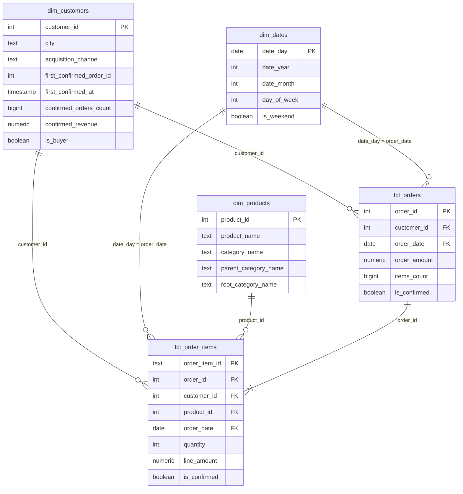

# Хранилище данных интернет-магазина

Исходные данные магазина находятся в PostgreSQL.
Загрузчик копирует их в схему raw базы Greenplum.
В dbt подготовлены слои staging, intermediate и marts.

## Модель данных

| Витрина | Одна строка | Бизнес-вопрос |
| --- | --- | --- |
| dim_customers | Один клиент, включая клиентов без покупок | Какова доля покупателей по каналам привлечения и сколько покупок у каждого клиента? |
| dim_products | Один товар с брендом и иерархией категорий | Какие категории приносят выручку и товары каких брендов возвращают? |
| dim_dates | Один календарный день | Как меняются продажи по месяцам и дням недели? |
| fct_orders | Один нетестовый заказ | Каков средний чек по городам и сколько разных товаров в заказе? |
| fct_order_items | Один товар в нетестовом заказе | Какова выручка по товарам, брендам и категориям? |



PK и FK на схеме обозначают логические ключи. Их уникальность, заполненность
и связи между фактами и измерениями проверяются тестами dbt.
На диаграмме показана часть атрибутов; полный список есть в документации dbt.

### Хранение в Greenplum

| Витрина | Распределение | Хранение | Обоснование |
| --- | --- | --- | --- |
| dim_customers | REPLICATED | heap | Небольшой справочник клиентов. Копия на каждом сегменте позволяет соединять его с фактами без пересылки строк. |
| dim_products | REPLICATED | heap | Небольшой справочник товаров и категорий. Копия доступна на каждом сегменте. |
| dim_dates | REPLICATED | heap | Календарь из 133 строк. Копия доступна на каждом сегменте. |
| fct_orders | BY (order_id) | append-optimized, column | Ключ совпадает с fct_order_items и сырыми заказами, позициями и платежами. Колоночное хранение подходит для отчетов по выбранным полям. |
| fct_order_items | BY (order_id) | append-optimized, column | Заказ и его позиции находятся на одном сегменте. Для расчета выручки можно читать нужные столбцы. |

Для небольших справочников достаточно строкового хранения heap.
При разных ключах распределения фактов Greenplum может пересылать строки
между сегментами перед соединением по order_id.

### Граф зависимостей dbt


## Правила расчетов

Подтвержденная покупка имеет статус paid и хотя бы одну успешную платежную
операцию с суммой больше или равной нулю. Возврат - успешная операция
с отрицательной суммой. Заказы со статусом test исключены из обеих таблиц фактов.

Выручку подтвержденных покупок считаем по order_amount в fct_orders
или по line_amount в fct_order_items при is_confirmed = true.
После соединения заказа с позициями его order_amount повторяется в каждой строке:
суммировать это поле в таком результате нельзя.

Платежи и число разных товаров группируются по заказу до соединения.
Скидка относится ко всей позиции: line_amount = quantity * unit_price - discount_amount.

Первую покупку клиента определяем по ordered_at, при одинаковом времени - по order_id.
first_confirmed_at содержит время оформления этого заказа.
У клиента без покупок первая покупка и ее время равны null,
число покупок и выручка равны 0, is_buyer = false.

Календарь охватывает все дни от минимальной до максимальной даты исходных заказов.
На текущих данных это 133 дня с 2026-03-01 по 2026-07-11.
Нумерация дней недели: понедельник - 1, воскресенье - 7.
is_weekend отмечает субботу и воскресенье.

Модель товаров раскрывает до трех уровней категорий.
root_category_name содержит верхнюю категорию: Electronics или Home.
При добавлении четвертого уровня нужно расширить модель иерархии.

Справочники клиентов и товаров хранят текущее состояние.
При пересборке новые значения заменяют прежние. Такой подход соответствует SCD Type 1:
история изменений города, бренда или категории не сохраняется.

## Проверки данных

Generic-тесты проверяют первичные ключи staging и marts, связи фактов с измерениями
и допустимые статусы. Собственный тест non_negative проверяет денежные суммы
и счетчики на отрицательные значения. Для этих полей также задан not_null.

Singular-тесты проверяют:

- совпадение стоимости заказа с суммой его позиций;
- совпадение суммы и числа подтвержденных покупок с расчетом по исходным заказам и платежам;
- полный возврат денег по возвращенным заказам;
- отсутствие переплаты по подтвержденным заказам;
- отсутствие тестовых заказов в фактах;
- соответствие is_confirmed успешным оплатам;
- допустимость возврата по статусу заказа;
- полноту календаря между первой и последней датой заказа.

В исходных данных у заказа 113 стоимость 200 рублей, а успешные списания составляют
400 рублей: две операции по 200. Тест assert_confirmed_orders_not_overpaid
настроен с severity: warn. Предупреждение фиксирует двойное списание,
исходные данные сохранены без исправления этой ошибки.

Проверка на чистых базах прошла: 14 моделей и 87 тестов,
PASS=100, WARN=1, ERROR=0. Контрольные значения совпали с заданием:
135 заказов, 425 позиций, 106 подтвержденных покупок на 91 620 рублей,
29 покупателей и 11 клиентов без покупок.

## Дополнительное задание

Подключен пакет dbt_utils версии 1.3.3 из официального репозитория dbt-labs/dbt-utils.
В dim_dates используется dbt_utils.date_spine:
он строит календарь между границами дат исходных заказов.
Верхняя граница date_spine не включается, поэтому к последней дате добавлен один день.
Перед первой сборкой нужно установить пакет:

```bash
docker compose run --rm dbt deps
```
