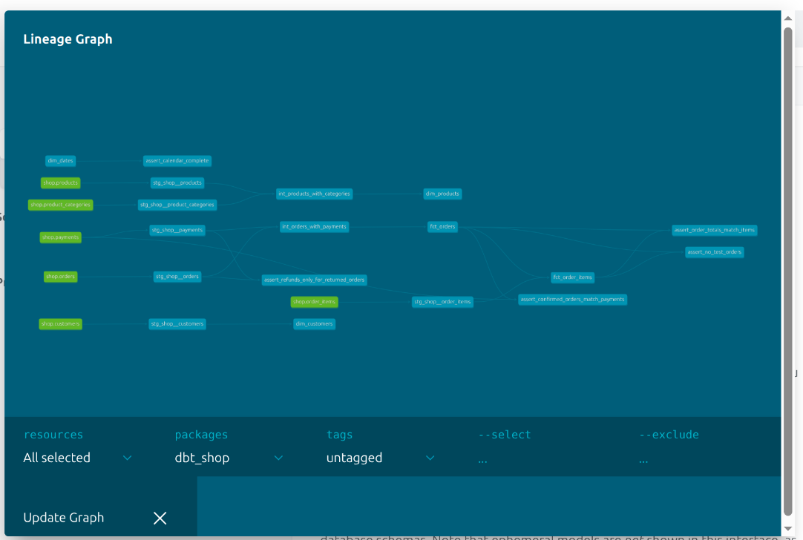
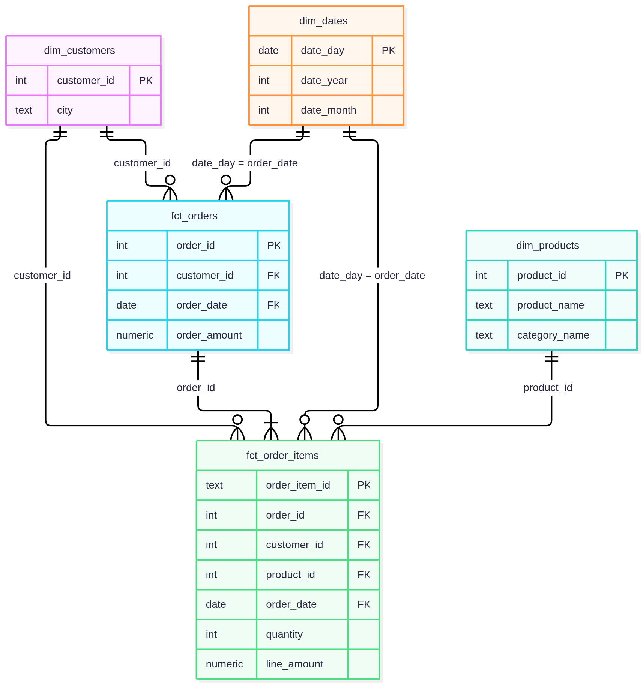

# Хранилище данных интернет-магазина

Исходные данные магазина находятся в PostgreSQL.
Загрузчик копирует их в схему raw базы Greenplum.
dbt строит таблицы для анализа заказов
по датам, клиентам и категориям товаров.

## Таблицы

- `dim_customers`: один клиент, включая клиента без заказов.
- `dim_products`: один товар с иерархией категорий.
- `dim_dates`: один календарный день.
- `fct_orders`: один нетестовый заказ.
- `fct_order_items`: один товар в нетестовом заказе.

## Хранение в Greenplum

Таблица - dim_customers, Распределение - REPLICATED, Хранение - heap, Обоснование - Небольшой справочник клиентов: копия доступна на каждом сегменте

Таблица - dim_products, Распределение - REPLICATED, Хранение - heap, Обоснование - Небольшой справочник товаров и категорий: копия доступна на каждом сегменте

Таблица - dim_dates, Распределение - REPLICATED, Хранение - heap, Обоснование - Календарь из 365 строк: копия доступна на каждом сегменте

Таблица - fct_orders, Распределение - BY (order_id), Хранение - append-optimized, column, Обоснование - Распределение совпадает с позициями; колоночное хранение подходит для чтения выбранных столбцов в отчетах

Таблица - fct_order_items, Распределение - BY (order_id), Хранение - append-optimized, column, Обоснование - Заказ и его позиции находятся на одном сегменте; для расчетов можно читать выбранные столбцы

## Границы модели

Календарь охватывает 2026 год.
Модель товаров раскрывает до трех уровней категорий.

Справочники клиентов и товаров хранят текущее состояние.
При пересборке новые значения заменяют прежние.
Такой подход соответствует SCD Type 1:
история изменений города, бренда или категории не сохраняется.

## Граф зависимостей dbt

## Схема таблиц

